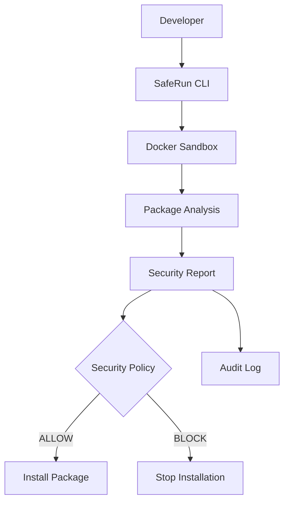

[](...)
[](...)
[](...)

# SafeRun

SafeRun is a secure package installation sandbox for developers who want to inspect npm packages before they run in a project. It addresses software supply chain attacks by analyzing package metadata, lifecycle scripts, files, processes, and network activity inside an isolated Docker environment before installation is approved.

Instead of trusting a package immediately:

```bash
npm install lodash
```

run the installation through SafeRun:

```bash
saferun npm install lodash
```

SafeRun analyzes the package in a disposable sandbox, produces a security report and risk score, applies a security policy, and records the result in a local audit log. Low-risk packages can be approved for installation; packages that violate the policy are blocked.

## How It Works



SafeRun currently supports npm package installation and uses Docker to provide isolation. The analysis includes package metadata, lifecycle scripts, suspicious files, process activity, and network activity observed during the sandboxed operation.

## Installation

SafeRun requires Docker. Install Docker separately before running `saferun setup`.

### Linux and macOS

```bash
curl -fsSL https://www.saferun.tech/install.sh | sh
```

### Windows PowerShell

```powershell
irm https://www.saferun.tech/install.ps1 | iex
```

The installers download the selected GitHub Release binary, verify its SHA-256 checksum, and install it without requiring Go or a repository checkout. Set `SAFERUN_VERSION` to install a specific release. The Windows installer supports `amd64` and `arm64` and adds its per-user installation directory to `PATH`.

## Quick Start

```bash
saferun setup
saferun npm install lodash
saferun audit
saferun audit --clear
```

`saferun setup` checks Docker, verifies the sandbox image, and downloads it when necessary. The npm command resolves and reviews the complete dependency tree before asking for approval to install it in the current project.

## Installing Project Dependencies

From a Node.js project, SafeRun can analyze the complete dependency set before installing it:

```bash
git clone https://github.com/example/project.git
cd project
saferun npm install
```

SafeRun stages the project and resolves a lockfile with scripts disabled. Project installs reuse an existing compatible lockfile. SafeRun verifies each registry tarball's integrity and runs `npm ci` in Docker against the staged lockfile. After approval it runs `npm ci --ignore-scripts` in a separate host staging directory against that same lockfile. It verifies the installed package identities and integrity records before replacing the project's dependencies. SafeRun snapshots the project's npm metadata and dependency tree before publishing so it can restore them if installation fails.

Host lifecycle scripts are disabled by default. When a dependency needs a host build, run `saferun npm install <package> --allow-host-scripts` and answer the separate confirmation for `npm rebuild`. Those scripts run with your account's filesystem access. `--ignore-scripts` also disables lifecycle scripts in Docker.

Verified installation supports dependencies with SHA-512 integrity from the public npm registry and npm lockfile versions 2 and 3. Local directories, `file:`, workspaces, git, GitHub, standalone tarball URLs, npm aliases, project `.npmrc`, and npm shrinkwrap files are unsupported. Symlinked project inputs are also rejected.

## CLI Output

A package analysis includes a security report, risk score, and policy decision:

```text
SafeRun Security Report
-----------------------
Package: lodash@4.17.21

Risk Summary
------------
Risk: LOW
Score: 0
Findings: 0

Security Policy
---------------
Decision: ALLOW
Install lodash@4.17.21 in your project? [y/N]
```

Higher-risk results include the relevant findings and can end with a `BLOCK` decision. Medium-risk results may require explicit confirmation. Every analysis outcome is recorded locally and can be reviewed with:

```bash
saferun audit
```

## JSON and SARIF Output

Use `--json` (or `--format=json`) when a script or CI/CD pipeline needs to consume the security result without terminal formatting or progress output, or `--format=sarif` to generate SARIF v2.1.0 output for GitHub Code Scanning:

```bash
saferun npm install express --json
saferun npm install --format=sarif > saferun.sarif
```

Machine-readable modes scan only. Exit status `0` means the scan passed, `3` means the policy prevented an unattended install, and `1` means the scan failed. A policy block emits a report as well.

Common npm install aliases (`saferun npm i <package>` and `saferun npm add <package>`) are also supported.

SafeRun writes one JSON report to standard output. It includes the package and version, risk level and findings, behavior/process/network/file analysis, policy decision, and timestamp:

```json
{
  "package": "lodash",
  "version": "4.18.1",
  "risk": {
    "level": "LOW",
    "score": 0,
    "findings": []
  },
  "analysis": {
    "behavior": { "suspicious": false },
    "processes": [],
    "network": ["registry.npmjs.org:443"],
    "files": []
  },
  "policy": { "decision": "ALLOW" },
  "timestamp": "2026-09-05T00:00:00Z"
}
```

Errors in JSON mode use the same machine-readable output, with `error` and `message` fields. CI/CD systems can parse standard output as JSON and use the command exit status to fail blocked or unsuccessful checks.

Example audit output:

```text
SafeRun Audit Log
-----------------
TIMESTAMP           | DECISION     | PACKAGE                         | RISK    | INSTALL      | VERIFY       | ROLLBACK           | APPROVAL
2026-09-05 12:30    | ALLOW        | lodash                          | LOW     | SUCCESS      | PASSED       | -                 | ACCEPTED
  score: 0 | findings: 0
```

Use `saferun audit --all` to display the complete history or `saferun audit --clear` to remove it. The default audit file is stored at `~/.saferun/audit.jsonl`.

## Configuration (`.saferunrc`)

Create a `.saferunrc` JSON file in your project root (or `~/.saferunrc`, or point `SAFERUN_CONFIG` to a custom file) to customize sandbox limits, allowed hosts, policy strictness, and OSV vulnerability checks:

```json
{
  "sandbox": {
    "memory": "1g",
    "cpus": "2",
    "pids_limit": 256,
    "timeout": "10m"
  },
  "network": {
    "allowed_hosts": ["npm.internal.corp", "*.artifactory.local"]
  },
  "policy": {
    "block_on_medium": true
  },
  "osv": {
    "enabled": true
  }
}
```

OSV checks apply to direct and transitive packages. If enabled and OSV is unavailable, the scan exits with an operational error. The `allowed_hosts` setting affects network findings after the sandbox run. Docker bridge networking permits outbound connections during the run.

## GitHub Action Integration

The composite action runs SafeRun on a Linux runner with Docker and `jq`. It builds SafeRun from the action's revision by default. The following workflow job checks a project and uploads findings to GitHub Code Scanning.

```yaml
jobs:
  saferun:
    runs-on: ubuntu-latest
    permissions:
      contents: read
      security-events: write
    steps:
      - uses: actions/checkout@v4
      - uses: actions/setup-go@v5
        with:
          go-version-file: go.mod
      - uses: ./.github/actions/saferun
        with:
          upload-sarif: "true"
```

For a workflow in another repository, reference `dag12y/saferun/.github/actions/saferun@<commit-sha>` and set up Go for that SafeRun revision. You can also set `saferun-version` to an existing release with the action's exit-code contract. A policy block uploads the report before failing the job. Setup failures and failed analyses stop the job with their own error messages. The `sarif-file` input defaults to `saferun.sarif` and accepts a path under the checked-out workspace with an existing parent directory.

## Supported Platforms

- Linux
- macOS
- Windows

SafeRun uses Docker for sandboxing, so Docker must be installed and running on the selected platform.

## Project Structure

```text
saferun/
├── cmd/
│   └── saferun/
│       └── main.go
├── internal/
│   ├── analyzer/
│   ├── audit/
│   ├── cli/
│   ├── monitor/
│   ├── package_manager/
│   ├── report/
│   ├── risk/
│   └── sandbox/
├── pkg/
├── sandbox/
│   └── images/
│       └── node/
│           └── Dockerfile
├── tests/
├── docs/
├── go.mod
└── README.md
```

## Development

### Requirements

- Linux, macOS, or Windows with WSL
- Go 1.25 or later
- Docker
- Node.js and npm
- Git

### Run from source

```bash
go run ./cmd/saferun setup
go run ./cmd/saferun npm install express
```

Build the CLI with:

```bash
go build -o saferun ./cmd/saferun
```

Use the built-in help and version commands:

```bash
saferun --help
saferun --version
```

### Manual GitHub Release Installation

Download the binary for your platform and `SHA256SUMS` from the [SafeRun v2.0.0 release](https://github.com/dag12y/saferun/releases/tag/v2.0.0). Verify the binary against `SHA256SUMS`, then install it as `~/.local/bin/saferun`:

```bash
mkdir -p ~/.local/bin
install -m 0755 saferun-linux-amd64 ~/.local/bin/saferun
```

The Linux and macOS installer installs to `~/.local/bin/saferun` by default. If that directory is not in `PATH`, the installer prints the command needed to add it. The installer does not install Docker.

### Windows Installation Details

The PowerShell installer installs `saferun.exe` to `%LOCALAPPDATA%\SafeRun\bin` by default and adds that directory to the user `PATH` without requiring Administrator privileges. Open a new PowerShell session after installation so the updated `PATH` is loaded.

To update, run the installer again. To remove SafeRun, delete `%LOCALAPPDATA%\SafeRun\bin\saferun.exe` and remove that directory from the user `PATH`.

Configuration variables:

- `SAFERUN_VERSION`: release tag, such as `v2.0.0`
- `SAFERUN_RELEASE_BASE_URL`: HTTPS release base URL; defaults to `https://github.com/dag12y/saferun/releases/download`
- `SAFERUN_INSTALL_DIR`: per-user installation directory; defaults to `%LOCALAPPDATA%\SafeRun\bin`

For example, to install a specific Windows release:

```powershell
$env:SAFERUN_VERSION = 'v2.0.0'
$env:SAFERUN_INSTALL_DIR = "$env:LOCALAPPDATA\SafeRun\bin"
irm https://www.saferun.tech/install.ps1 | iex
```

If the command is not found after installation, open a new terminal so the updated `PATH` is loaded. Confirm Docker is installed and running with `saferun setup`; the SafeRun installers do not install Docker.

## Roadmap

### Completed

- ✓ npm package sandboxing
- ✓ Docker isolation
- ✓ Security reports
- ✓ Cross-platform installers
- ✓ Audit management
- ✓ GitHub Action integration

### Future

- More package managers
- AI-powered security explanations

See [ROADMAP.md](ROADMAP.md) for the public roadmap.

## Releases

SafeRun provides prebuilt release binaries for Linux, macOS, and Windows. The release process publishes cross-platform binaries and SHA-256 checksums for each tagged version.

## License

SafeRun is licensed under the Apache License 2.0. See [LICENSE](LICENSE) for the full license text.
